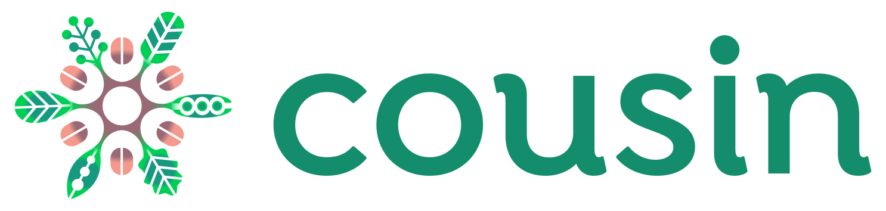
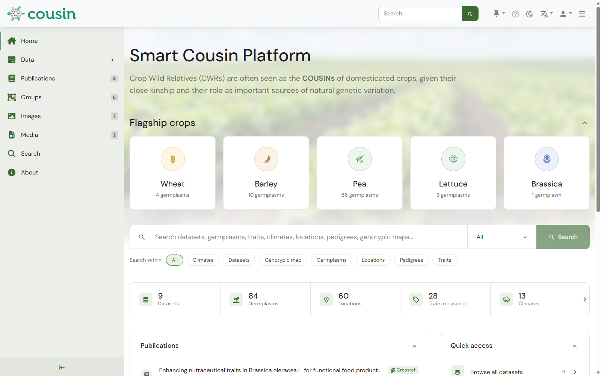
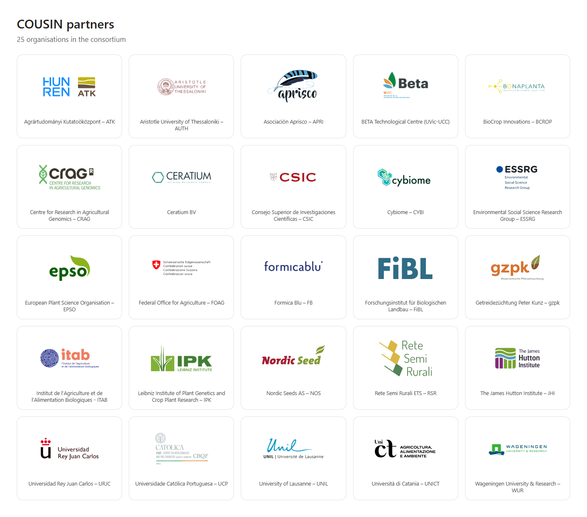
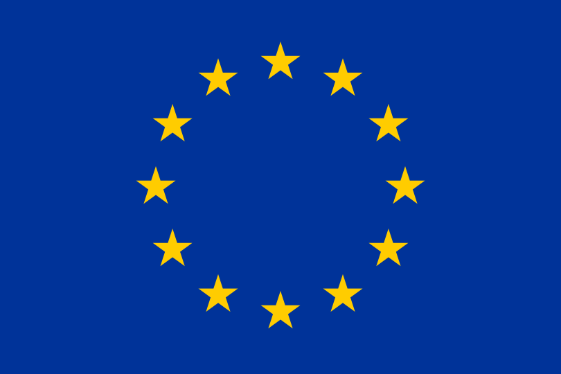

<h1 align="center">
  
   
  COUSIN Germinate
</h1>

  <b>The data platform of the COUSIN project: Crop Wild Relatives for a sustainable agriculture.</b>
   
  A fork of <a href="https://github.com/germinateplatform/germinate-vue">Germinate</a>, the open source plant genetic resources database of The James Hutton Institute.

  
  
  

> [!NOTE]
> **This repository is a fork of [germinateplatform/germinate-vue](https://github.com/germinateplatform/germinate-vue).**
> Germinate is developed by the Information and Computational Sciences group of [The James Hutton Institute](https://www.hutton.ac.uk/).
> For Germinate itself (documentation, downloads, demo, support) see the
> [Germinate website](https://ics.hutton.ac.uk/get-germinate).

## About COUSIN

Crop Wild Relatives (CWRs) are often seen as the *cousins* of domesticated crops: they are their close kin and an
important source of natural genetic variation. Crop diversification and breeding are key tools for the agroecological
transition of European food systems, and CWRs can play a central role as custodians of diversity.

COUSIN develops and implements a roadmap for the use of CWRs to breed new cultivars supporting the agroecological
transition. For five flagship crops (**wheat, barley, pea, lettuce and brassica**), representing cereals, legumes, leafy
greens, vegetables and oilseed crops, it shows how the challenges of stakeholders from farm to fork can be overcome by
using CWRs in formal and participatory breeding.

### Objectives

| | |
|---|---|
| **Identify** | Pathways to use Crop Wild Relatives to strengthen sustainable agriculture. |
| **Recognize** | Preferred areas for the conservation and monitoring of priority CWR species in Europe, and implement their *trans situ* conservation. |
| **Determine** | The characteristics of CWRs demanded by stakeholders. |
| **Implement** | These stakeholder-demanded characteristics in breeding activities. |
| **Provide** | Information about CWRs in an accessible format to stakeholders and potential users. |
| **Train and raise awareness** | About the value of Crop Wild Relatives in society. |

### COUSIN Readiness Levels

The project developed the COUSIN Readiness Levels (CRL): nine steps from a wild relative recorded in a database to a
variety grown in farmers' fields.

1. **Identified in databases**: the CWR is identified in species distribution databases.
2. **Identified in situ**: the CWR is found in its natural habitat.
3. **Characterised in situ**: the CWR is characterised where it grows.
4. **Available ex situ**: the CWR is conserved in gene banks with its passport data. ← *this platform*
5. **Characterised ex situ**: stress tolerance, nutritional properties and other agronomic traits are assessed.
6. **Early crosses**: early interspecific crosses with the CWR and early selection.
7. **Advanced populations**: crosses and backcrosses with selection create advanced populations.
8. **Novel cultivar or OHM**: a novel cultivar (DUS) or an organic heterogeneous material (OHM) is defined.
9. **In farmers' fields**: registered varieties and OHM are grown to produce food and feed.

### Work packages

The project is organised into seven work packages. This platform is part of **WP5, Data provisioning**:

| WP | Title | |
|---|---|---|
| 1 | Participation and co-design | Co-creating the contexts for Crop Wild Relatives |
| 2 | Conservation | Monitoring and conservation of Crop Wild Relatives |
| 3 | Characterisation | Trait characterisation of CWRs and pre-breeding germplasm |
| 4 | Breeding and farming | Implementing CWRs in breeding and farming |
| **5** | **Data provisioning** | **High-quality data resources: the data management plan, the project data platform, consolidation of diversity, climate, land use, conservation and characterisation data, and a catalogue of CWR genetic resources** |
| 6 | Communication and training | Communication, dissemination, exploitation and training |
| 7 | Project management | Coordination of the project |

## Partners

## Funding

  
  &nbsp;&nbsp;
  
  &nbsp;&nbsp;
  

COUSIN is funded by the European Union (Horizon Europe, grant agreement 101135314), the Swiss State Secretariat for
Education, Research and Innovation (SERI contract number 22.0412) and UK Research and Innovation (UKRI). Views and
opinions expressed are however those of the author(s) only and do not necessarily reflect those of the European Union
or REA, nor SERI or UKRI.

## Credits and license

Germinate is developed by [The James Hutton Institute](https://www.hutton.ac.uk/) and released under the
[Apache License 2.0](LICENSE), which also applies to this fork. If you use Germinate, please cite it:
[10.5281/zenodo.14858537](https://doi.org/10.5281/zenodo.14858537). The original README, funders and acknowledgements
of Germinate are in the [upstream repository](https://github.com/germinateplatform/germinate-vue#readme).
